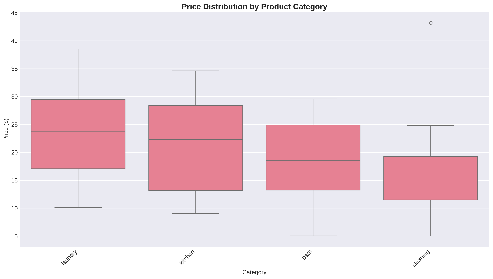
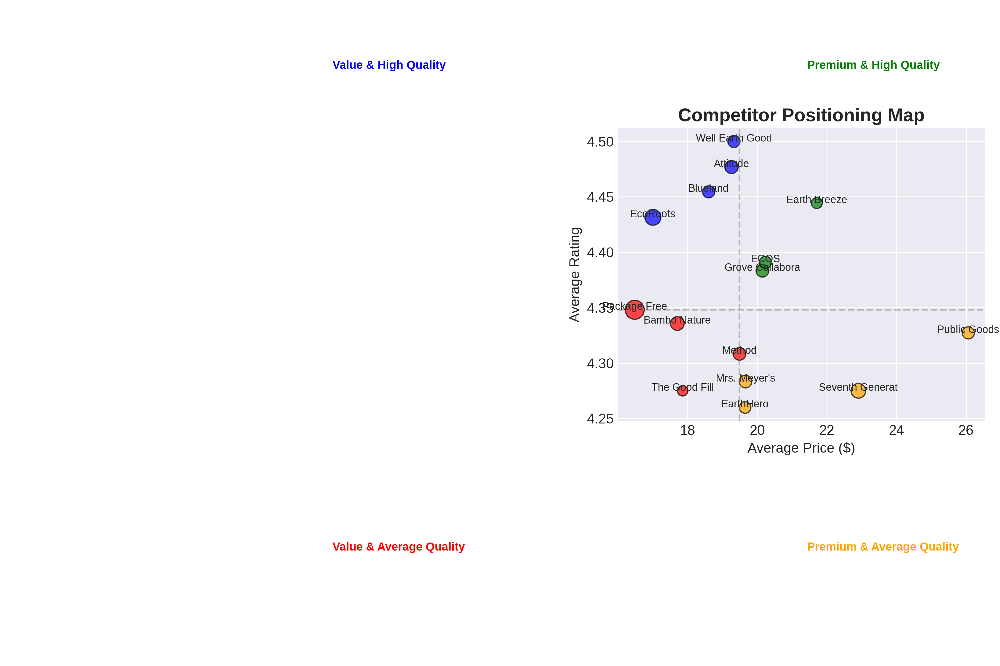
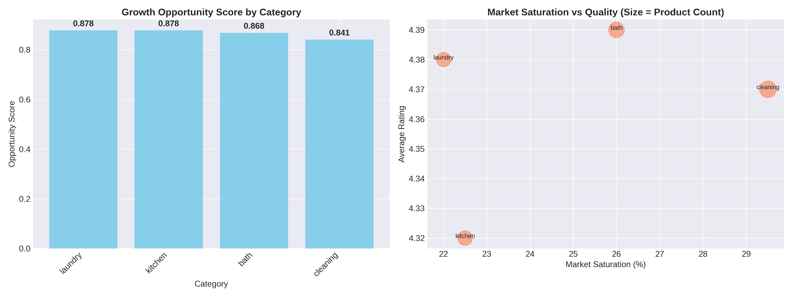
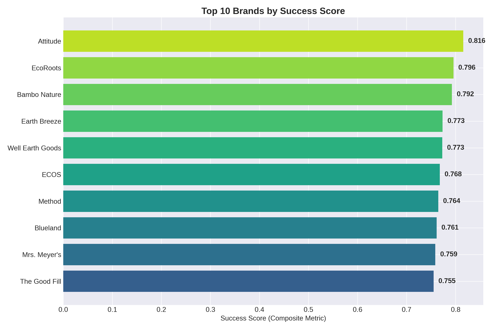

# 🌿 Eco-Friendly Market Intelligence System

> **An end-to-end market intelligence workflow that turns messy product data into pricing, competitor and category-growth decisions.**

[](https://www.python.org/)
[](https://pandas.pydata.org/)
[](https://plotly.com/python/)
[](#)

---

## Executive pitch

This project demonstrates how I approach **research, analytics and decision support as a complete workflow—not as isolated charts**.

Starting with product-level market data, the system:

**collects → validates → cleans → enriches → analyses → visualises → interprets → reports → recommends.**

It answers practical commercial questions such as:

- Where is the strongest pricing opportunity?
- Which competitors combine perceived quality with attractive pricing?
- Which categories appear under-served or strategically attractive?
- Which sustainability attributes command a price premium?
- Where should a product or pricing team focus next?
- How can the analysis be refreshed as new market snapshots arrive?

The result is a reproducible Python-based market-intelligence system with **data-quality controls, derived business metrics, interactive dashboards and an executive-ready report**.

---

## ⭐ Why this project is relevant to hiring managers

This is intentionally broader than a data-analysis exercise. It demonstrates five capabilities that matter in research and insights roles:

| Capability | Evidence in the project |
|---|---|
| **Research & problem framing** | Converts broad market questions into measurable analytical questions |
| **Data engineering** | Standardisation, missing-data handling, validation, feature engineering and reproducible pipelines |
| **Quantitative analysis** | Pricing distributions, discounts, category benchmarking, correlations, competitor scoring and opportunity modelling |
| **Insight communication** | Executive summary, interactive dashboards, visualisations and a boardroom-friendly PDF/HTML report |
| **Decision orientation** | Findings are translated into pricing, category and competitive recommendations |

### Technical stack

**Python · Pandas · NumPy · Matplotlib · Seaborn · Plotly · ReportLab · Excel/CSV**

---

# 📊 Portfolio snapshot

The current offline demonstration contains:

- **200** product records
- **17** brands
- **4** product categories
- **5** source labels
- Average listed price: **$19.45**
- Median listed price: **$18.73**
- Average rating: **4.36/5**
- **28%** of products marked as on sale
- **15** manually captured source records
- **185** explicitly labelled synthetic demonstration records

> **Important:** The dataset is a portfolio demonstration dataset, not a claim of 200 live-market observations. See [`DATA_PROVENANCE.md`](DATA_PROVENANCE.md) for the full provenance and responsible-use statement.

---

# 🔎 The business questions

The system was designed around four decision areas.

### 1. Pricing intelligence

- What is the market price distribution?
- Which categories support higher price points?
- How deep are discounts?
- Is higher price associated with higher ratings?
- Where are premium price positions visible?

### 2. Competitive intelligence

- Which brands have the strongest product-level performance?
- Who leads by catalogue presence?
- Which brands occupy value vs premium positions?
- Which brands appear to combine price and quality effectively?

### 3. Category opportunity

- Which categories combine demand proxies, quality and pricing characteristics?
- Which categories are relatively saturated?
- Where might a new or expanded product range be positioned?

### 4. Sustainability intelligence

- Which sustainability attributes are most common?
- Which attributes appear associated with price premiums?
- Are sustainability claims concentrated in particular categories or brands?

---

# 🧠 Analytical methodology

## 1. Data acquisition

The project supports two acquisition paths:

1. **Licensed/static source data**, such as a Kaggle dataset or approved data export.
2. **Demonstration mode**, which uses a transparent combination of manually captured and synthetic records so the entire workflow can run offline.

Eco-related products are identified using keyword and category logic covering terms such as:

- sustainable
- eco-friendly
- bamboo
- recycled
- biodegradable
- compostable
- reusable
- refillable
- plastic-free
- zero-waste
- plant-based

The collection layer is designed to be replaceable with a production API, licensed feed or approved scheduled data source.

---

## 2. Data quality and cleaning

The cleaning workflow addresses common market-data problems:

- inconsistent column names;
- missing values;
- inconsistent categorical labels;
- invalid prices;
- rating range validation;
- review-count type conversion;
- duplicate records;
- text normalisation;
- sustainability attribute extraction;
- price-tier classification;
- discount calculation.

The project also maintains a cleaning log and data dictionary so that transformations are traceable.

### Quality principle

A key design choice is **not silently fabricating critical business fields**. Missingness should be handled according to the analytical purpose, and demo/synthetic records are explicitly labelled rather than presented as observed market evidence.

---

# 📐 Derived analytical metrics

### Discount %

\[
Discount\% = \frac{List\ Price - Sale\ Price}{List\ Price}\times100
\]

### Price premium

Products are benchmarked against their category average to identify relative price positioning.

### Success Score

A composite prioritisation metric combines:

- customer rating;
- review-volume signal;
- relative price attractiveness.

The score is designed for **screening and benchmarking**, not as a causal measure of commercial success.

### Category Opportunity Score

Categories are assessed using a combination of market presence, quality and pricing-related signals to identify areas worthy of deeper investigation.

> In a production setting, the weights should be agreed with commercial stakeholders and sensitivity-tested before being used for investment decisions.

---

# 💡 Illustrative findings from the current demonstration

The current analytical run produces several useful examples of how the system communicates evidence.

### Pricing

**Laundry** has the highest average listed price at approximately **$23.79**, compared with:

- Kitchen: **$21.34**
- Bath: **$18.48**
- Cleaning: **$15.61**

The overall market discount rate is approximately **20.6%** among discounted observations.

### Price vs perceived quality

The price-rating correlation is approximately **-0.03**, indicating **little linear relationship** between price and rating in this demonstration dataset.

That is more useful than simply saying "premium products are better": it suggests price alone should not be treated as a proxy for perceived product quality.

### Competitive landscape

The current success-score ranking places **Attitude, EcoRoots and Bambo Nature** among the strongest-performing brands under the project's composite metric.

The highest-volume brands are led by **Package Free, EcoRoots and Seventh Generation**.

### Sustainability attributes

The most frequently observed sustainability attributes include:

- natural;
- plastic-free;
- biodegradable;
- compostable;
- sustainable.

The demonstration analysis estimates an approximately **8.2% price premium** for products containing a "sustainable" attribute relative to the comparison group.

> These findings are deliberately labelled as **demonstration insights**, because most of the dataset is synthetic.

---

# 📈 Visual intelligence

### Price distribution



The boxplot makes category-level pricing differences immediately visible and helps identify where price ranges overlap or diverge.

### Competitive positioning



Brands are positioned by average price and average rating, creating a simple **value vs premium / quality positioning map**.

### Category opportunity



The opportunity matrix combines category-level signals into a prioritisation view rather than leaving the user to interpret disconnected charts.

### Brand performance



The ranking provides a quick starting point for competitor deep-dives while making the scoring methodology explicit.

---

# 🖥️ Deliverables

The repository contains multiple ways to consume the analysis.

### Interactive dashboards

- [`Dashboard index`](dashboard_index.html)
- [`Price analysis`](dashboard_price_analysis.html)
- [`Competitor analysis`](dashboard_competitor_analysis.html)
- [`Market trends`](dashboard_market_trends.html)

### Executive reporting

- [`Enhanced HTML insight report`](enhanced_monthly_report.html)
- [`Enhanced PDF insight report`](4_monthly_insight_report_enhanced.pdf)
- [`Executive summary`](analysis_results/executive_summary.md)

### Data and methodology

- [`Clean master dataset`](clean_master_dataset.csv)
- [`Excel dataset`](clean_master_dataset.xlsx)
- [`Data dictionary`](data_dictionary.md)
- [`Data provenance`](DATA_PROVENANCE.md)
- [`Cleaning summary`](cleaning_summary_report.md)
- [`Workflow documentation`](enhanced_workflow_documentation.md)

---

# 🏗️ Architecture

```text
                 ┌────────────────────────────┐
                 │     Source / Demo Data     │
                 └─────────────┬──────────────┘
                               │
                               ▼
                 ┌────────────────────────────┐
                 │  1. Data Collection Layer │
                 │  • source mapping         │
                 │  • eco-product filtering  │
                 │  • enrichment             │
                 └─────────────┬──────────────┘
                               │
                               ▼
                 ┌────────────────────────────┐
                 │   2. Data Quality Layer   │
                 │  • validation             │
                 │  • cleaning               │
                 │  • deduplication          │
                 │  • feature engineering    │
                 └─────────────┬──────────────┘
                               │
                               ▼
                 ┌────────────────────────────┐
                 │ 3. Intelligence Layer     │
                 │  • pricing                │
                 │  • competitors            │
                 │  • category opportunity   │
                 │  • sustainability         │
                 └─────────────┬──────────────┘
                               │
                               ▼
                 ┌────────────────────────────┐
                 │ 4. Communication Layer    │
                 │  • Plotly dashboards      │
                 │  • visualisations         │
                 │  • HTML report             │
                 │  • PDF report             │
                 └─────────────┬──────────────┘
                               │
                               ▼
                 ┌────────────────────────────┐
                 │ 5. Decision Support       │
                 │  • opportunities          │
                 │  • pricing implications   │
                 │  • competitor actions     │
                 └────────────────────────────┘
```

---

# 🚀 Run the project locally

## 1. Clone/download the repository

```bash
git clone <your-repository-url>
cd "EFHGoods Market Intelligence System"
```

## 2. Create a virtual environment

### Windows

```bash
python -m venv .venv
.venv\Scripts\activate
```

### macOS/Linux

```bash
python3 -m venv .venv
source .venv/bin/activate
```

## 3. Install dependencies

```bash
pip install -r requirements.txt
```

## 4. Run the analytical pipeline

```bash
python Analysis_insights.py
```

This generates:

- analytical results;
- analysis-ready data;
- executive summary;
- market visualisations;
- insight JSON.

## 5. Generate the reporting and dashboards

```bash
python dashboard.py
```

This generates:

- interactive Plotly dashboards;
- HTML insight report;
- PDF insight report;
- dashboard index.

Then open:

```text
dashboard_index.html
```

No database or internet connection is required for the included demonstration workflow.

---

# 📁 Repository structure

```text
.
├── Analysis_insights.py
├── data_cleaning.py
├── data quality check.py
├── dashboard.py
├── python 1_data_collection_kaggle.py
│
├── clean_master_dataset.csv
├── clean_master_dataset.xlsx
├── phase1_collected_data.csv
├── manual_packagefree.csv
├── portfolio_demo_dataset.csv
│
├── analysis_results/
│   ├── analysis_ready_data.csv
│   ├── executive_summary.md
│   ├── full_analysis_results.pkl
│   └── insights_summary.json
│
├── analysis_visualizations/
│   ├── category_opportunity_matrix.png
│   ├── competitor_positioning_map.png
│   ├── price_distribution_by_category.png
│   └── top_brands_success_score.png
│
├── docs/
│   └── portfolio visualisation copies
│
├── dashboard_index.html
├── dashboard_price_analysis.html
├── dashboard_competitor_analysis.html
├── dashboard_market_trends.html
├── enhanced_monthly_report.html
├── 4_monthly_insight_report_enhanced.pdf
│
├── DATA_PROVENANCE.md
├── data_dictionary.md
├── cleaning_summary_report.md
├── enhanced_workflow_documentation.md
├── 1_data_sources.md
├── requirements.txt
└── README.md
```

---

# 🧪 Quality and reproducibility

The project is structured so that each major stage can be rerun independently:

**Collection → Cleaning → Analysis → Reporting**

Outputs are persisted rather than requiring the analyst to manually copy results between tools.

The workflow also documents:

- field definitions;
- transformations;
- analytical assumptions;
- data limitations;
- source provenance;
- generated outputs.

This makes the project easier to audit, explain and adapt.

---

# ⚠️ Limitations

A hiring-quality portfolio should be explicit about limitations.

1. The included demonstration dataset is small.
2. Most records are synthetic and should not be interpreted as market facts.
3. Product ratings and reviews are proxies for consumer response, not verified demand.
4. The Success Score is a prioritisation metric rather than a causal model.
5. Historical snapshots are required for genuine market-trend or month-over-month analysis.
6. Production deployment would require licensed/approved source feeds, stronger entity resolution, automated monitoring and stakeholder validation of metric definitions.

---

# 🔭 What I would build next

If this moved from portfolio prototype to production, the next iteration would add:

### Data engineering
- scheduled source ingestion;
- source-level freshness monitoring;
- automated schema validation;
- product/brand entity resolution;
- historical snapshots in a database or warehouse.

### Advanced analytics
- price elasticity modelling;
- time-series trend detection;
- anomaly detection;
- competitor assortment similarity;
- NLP-based sustainability-claim classification;
- sensitivity analysis for composite scores;
- scenario modelling for price changes.

### Decision intelligence
- alerts when competitors change price;
- category opportunity alerts;
- automated weekly executive briefs;
- configurable KPI definitions;
- role-based dashboards for commercial, research and product teams.

### Production architecture

```text
APIs / Licensed Feeds
        ↓
Orchestration
        ↓
Raw Data Store
        ↓
Validation + Transformation
        ↓
Analytical Warehouse
        ↓
Python / SQL Analytics
        ↓
BI / Dashboards / Alerts
        ↓
Commercial Decisions
```

---

# 🎯 What this project demonstrates about the analyst

The most important capability demonstrated here is not simply knowing Python.

It is the ability to move from:

> **"Here is a dataset."**

to:

> **"Here is the business question, here is how I validated the evidence, here is what the data says, here is what it does not say, and here is the decision I would recommend taking next."**

That is the core of effective **Research & Insights, Market Intelligence, Data Analytics and Evidence & Learning work**.

---

## Author

**Victor Otieno Opiyo**  
Evidence, Insights & MEL | Data Analytics | Applied Research  
Nairobi, Kenya

**Core tools:** Python · SQL · R · Power BI · Tableau · Pandas · Statistical Analysis · Data Visualisation · Research & Insights

